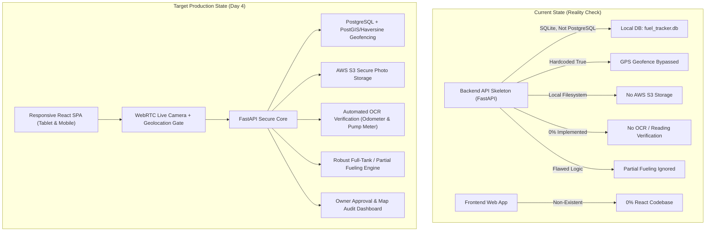
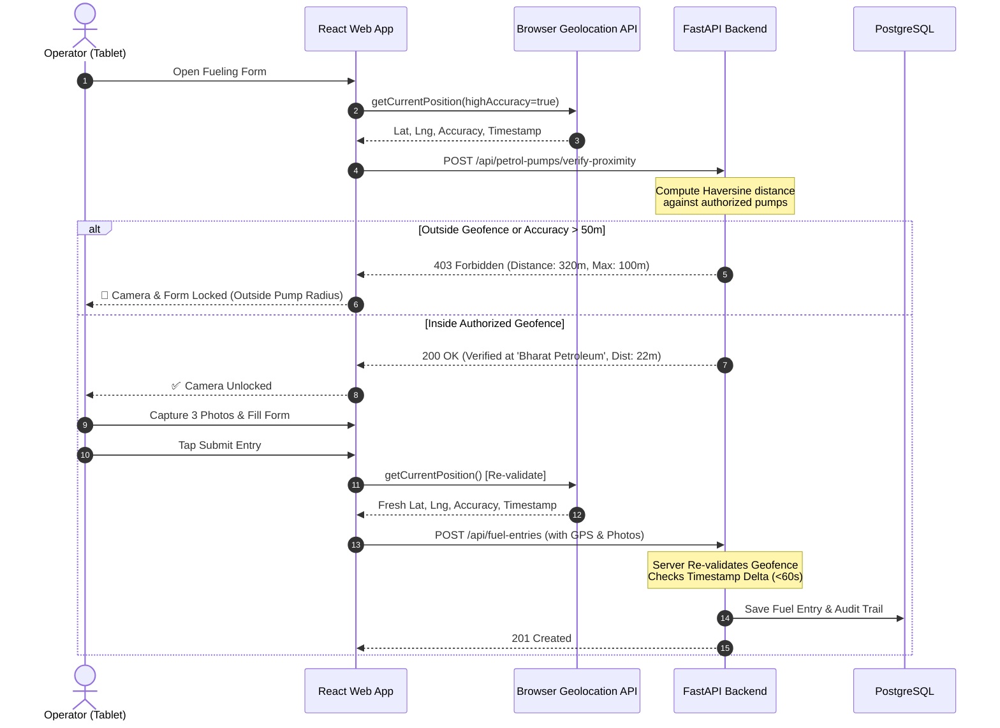
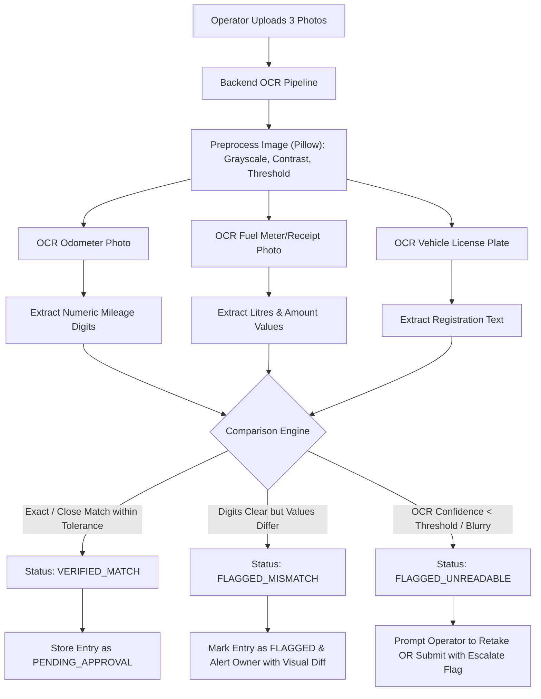
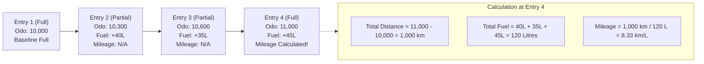
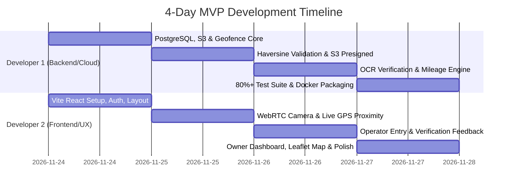

# Vehicle Fuel & Mileage Tracking System
## Codebase Inspection, Architectural Review & 4-Day Implementation Plan

---

### Executive Summary

An in-depth inspection of the `/Users/apple/projects/vehicle_management` repository was conducted to assess existing progress against the client's functional and non-functional requirements. 

**Key Finding:** While the initial backend developer laid out a clean relational foundation with FastAPI and SQLAlchemy models, **critical business logic, security verifications, cloud storage, and the entire frontend user interface are either incomplete or entirely missing**. The current codebase cannot be considered a functional MVP in its present state.



---

## 1. Codebase Audit & Gap Analysis

### 1.1 File-by-File Status

| Component | File Path | Current Status | Identified Issues / Deficiencies |
| :--- | :--- | :--- | :--- |
| **Config** | `backend/app/core/config.py` | ⚠️ Partially Implemented | Points to SQLite (`fuel_tracker.db`); `.env.example` contains syntax typos (`sqlitbbe:///`); AWS S3 configuration parameters are missing. |
| **Database** | `backend/app/core/database.py` | ⚠️ Partially Implemented | SQLite thread workarounds present; no connection pooling or retry handling for PostgreSQL. |
| **Security** | `backend/app/core/security.py` | ✅ Working Foundation | Bcrypt password hashing and JWT token creation implemented. Needs token revocation or role-hardening helpers. |
| **Models** | `backend/app/models/*.py` | ⚠️ Partially Implemented | Models (`User`, `Vehicle`, `PetrolPump`, `FuelEntry`, `EntryPhoto`, `AuditLog`) exist. Missing OCR confidence/extracted fields in `EntryPhoto`, missing idempotency/duplicate tracking, missing partial fuel accumulator. |
| **Routes: Fuel Entries** | `backend/app/routes/fuel_entries.py` | 🛑 Severe Logic Flaws | Geofence verification is **hardcoded to `True`**; photos are completely optional; mileage calculation breaks on partial refills; zero OCR reading verification. |
| **Routes: Petrol Pumps** | `backend/app/routes/petrol_pumps.py` | ⚠️ Basic CRUD only | Lacks proximity search endpoint or server-side coordinate validation endpoint. |
| **Routes: Vehicles** | `backend/app/routes/vehicles.py` | ⚠️ Inefficient | N+1 query vulnerability when calculating `latest_odometer`. |
| **Routes: Auth** | `backend/app/routes/auth.py` | ✅ Working | Validates username/password and issues role-embedded JWT token. |
| **Tests** | `backend/test_core_flow.py` | 🛑 Inadequate | Only 3 happy-path tests on SQLite; coverage is under 25%; `httpx` dependency missing from `requirements.txt`. |
| **Frontend** | `frontend/` | 🛑 Missing (0%) | No React.js application exists in the repository. |

---

### 1.2 Deep-Dive into Critical Logic Flaws & Vulnerabilities

#### Flaw 1: Bypassed GPS Geofencing (Highest Priority #1 Violation)
In `backend/app/routes/fuel_entries.py` (lines 85–89):
```python
new_entry = FuelEntry(
    ...
    latitude=entry_in.latitude,
    longitude=entry_in.longitude,
    accuracy_m=entry_in.accuracy_m,
    is_location_verified=True,  # BUG: Hardcoded! Distance from pump is never calculated!
    status="PENDING"
)
```
The server receives GPS coordinates but **never performs the Haversine distance calculation** against the pump coordinates (`pump.latitude`, `pump.longitude`). An operator can submit an entry from anywhere in the world and it will be recorded as `is_location_verified = True`.

#### Flaw 2: Zero Reading Verification (Highest Priority #2 Violation)
The requirement mandates: *"The manually entered odometer and fuel quantity must match the readings visible in the captured photos. Implement a reliable verification mechanism and handle unreadable or mismatched readings. Do not silently accept unverified values."*
In the current implementation:
- `FuelEntryCreate` accepts arbitrary numbers for `current_odometer` and `fuel_litres`.
- Attached photos are not analyzed. The system blindly stores unverified data in the database with status `PENDING`, violating the strict requirement.

#### Flaw 3: Broken Mileage Calculation on Partial Refueling
In `backend/app/routes/fuel_entries.py` (lines 68–73):
```python
distance_km = round(entry_in.current_odometer - previous_odometer, 2)
mileage_kmpl = None
if entry_in.is_full_tank and entry_in.fuel_litres > 0:
    mileage_kmpl = round(distance_km / entry_in.fuel_litres, 2)
```
*Why this fails:* In fleet management, if a vehicle undergoes partial refueling, mileage cannot be calculated until the next full tank. However, when that next full tank occurs, the calculation **must sum all fuel added during the partial fills** and calculate distance from the **last full tank**. The current code only looks back at the immediately preceding entry, discarding fuel added during intermediate partial fills and generating wildly inflated or incorrect mileage figures.

#### Flaw 4: Photo Attachments are Optional and Accept Arbitrary URLs
In `backend/app/schemas/fuel_entry.py`:
`photos: Optional[List[EntryPhotoCreate]] = []`.
An operator can submit a fueling record with `photos = []`. Furthermore, `photo_url` is accepted as a plain client-provided string; there is no image upload handler, no MIME validation, and no AWS S3 upload pipe.

#### Flaw 5: Duplicate Submissions Are Unchecked
There is no database constraint, submission timestamp check, or idempotency key preventing duplicate submissions if an operator double-clicks the submit button on a poor cellular connection.

---

## 2. Web Platform Limitations & Reasonable Safeguards

Because this is a **responsive web application (not a native app)**, web browsers present distinct architectural boundaries. Here is our assessment and safeguard strategy:

### 2.1 GPS Geofencing & Location Spoofing Safeguards



#### Browser GPS Limitations:
1. **Mock Locations & DevTools Overrides:** Android developer settings allow "Mock Location" apps. Desktop/tablet Chrome allows sensor overrides in DevTools.
2. **Cellular/Wi-Fi Drift:** Poor satellite line-of-sight near metal pump canopies can cause GPS drift of 50–100m.

#### Reasonable Safeguards Implemented:
1. **Accuracy Threshold Enforcement:** Enforce `coords.accuracy <= settings.MAX_ALLOWED_GPS_ACCURACY_METERS` (50 meters). If accuracy is degraded, prompt user to step outside canopy or wait for GPS lock.
2. **Server-Side Dual Validation:**
   - Pre-flight check: `/api/petrol-pumps/verify-proximity` unlocks camera.
   - Re-validation at submission: Server re-verifies coordinates against the target pump's radius using the spherical Haversine formula.
3. **Submission Timestamp Delta & Speed Check:**
   - Verify client GPS timestamp is within 60 seconds of server UTC time.
   - Detect unrealistic travel: Check time and distance from vehicle's previous entry. If speed exceeds 120 km/h, flag entry for manual audit.
4. **Audit Flagging:** Store exact coordinates, accuracy in meters, and computed distance from pump center in the database for owner map inspection.

---

### 2.2 Camera-Only Capture Safeguards

#### Browser Camera Limitations:
1. **File Picker Fallback:** HTML `<input type="file" accept="image/*" capture="environment">` instructs mobile OS to launch the camera, but certain mobile browsers (and desktop browsers) still allow users to browse file systems.
2. **No Hardware Attestation:** Unlike native iOS/Android SDKs (e.g., SafetyNet / Play Integrity / DeviceCheck), web browsers cannot cryptographically attest that an image came directly from a physical camera sensor.

#### Reasonable Safeguards Implemented:
1. **WebRTC Direct Stream Capture (`MediaDevices.getUserMedia`):**
   - The primary capture mechanism renders a live video stream onto a custom camera overlay with a viewfinder guide box (e.g., "Align Odometer Here").
   - When the user presses "Capture", a high-resolution snapshot is drawn directly to an HTML5 `<canvas>` and converted to a Blob. The file picker is never shown.
2. **Fallback with `capture="environment"`:**
   - For older mobile browsers lacking WebRTC permissions, fall back to `<input type="file" accept="image/*" capture="environment">`.
3. **Client-Side EXIF & Timestamp Validation:**
   - Extract EXIF metadata: Verify `DateTimeOriginal` is within 5 minutes of current time. Reject or flag images without recent camera timestamps or images containing editing software signatures (e.g., Photoshop, Canva).
4. **Duplicate Image Detection (Perceptual Hash):**
   - Calculate an image pHash / MD5 on the backend to prevent operators from uploading the same photo for multiple entries.

---

## 3. Reading Verification Architecture (Priority #2)

The client specifies: *"The manually entered odometer and fuel quantity must match the readings visible in the captured photos. Implement a reliable verification mechanism and handle unreadable or mismatched readings. Do not silently accept unverified values."*



### 3.1 OCR Pipeline Implementation
1. **Preprocessing with Pillow:**
   - Odometer displays often suffer from dashboard glare, low contrast, or LCD angle issues.
   - Preprocessing steps: auto-crop region of interest, convert to grayscale, apply CLAHE (Contrast Limited Adaptive Histogram Equalization), and binarize using Otsu's thresholding.
2. **Digit Extraction:**
   - Use Tesseract OCR (`pytesseract`) configured with `--psm 7 -c tessedit_char_whitelist=0123456789.` for odometer digits.
   - Use OCR receipt layout analysis for pump receipts to extract lines containing `Ltr`, `Litre`, `Volume`, or `Quantity`.
3. **Fuzzy & Substitution Handling:**
   - Common OCR substitutions handled: `O` <-> `0`, `I` / `l` <-> `1`, `B` <-> `8`, `S` <-> `5`.
4. **Three-Tier Verification Decision Matrix:**

| Condition | Status Code | UI / Workflow Consequence |
| :--- | :--- | :--- |
| OCR reading matches manual input within $\pm 0.5\%$ | `VERIFIED_MATCH` | Allowed to proceed; Owner sees green verified badge. |
| OCR found clear numbers, but manual entry differs by $> 1$ unit | `MISMATCH` | **Do not accept silently.** Operator gets a warning showing detected vs typed value. If submitted, entry is highlighted in red with mandatory Owner review. |
| Image too blurry, glare, or confidence $< 60\%$ | `UNREADABLE` | Operator is prompted to retake. If unable (broken LCD), operator submits with flagged note; Owner must manually confirm reading before approval. |

---

## 4. Mileage Calculation Engine: Mathematical Model

### 4.1 Full-Tank-to-Full-Tank Method with Intermediate Partials

In commercial freight transport, operators often purchase partial fuel fills between scheduled depot full fills. Mileage cannot be computed on a single partial fill, but **fuel consumed must not be lost**.



### 4.2 Algorithm Implementation:
$$\text{Distance} = \text{Odometer}_{\text{curr}} - \text{Odometer}_{\text{last\_full}}$$
$$\text{Total Fuel} = \sum_{i \in \text{uncalculated partials}} \text{Fuel}_i + \text{Fuel}_{\text{curr}}$$
$$\text{Mileage (km/L)} = \frac{\text{Distance}}{\text{Total Fuel}}$$

1. **If current entry is `is_full_tank == False`:**
   - `distance_km = current_odometer - previous_odometer`
   - `mileage_kmpl = None`
   - Status tag: `PARTIAL_REFUEL`
2. **If current entry is `is_full_tank == True`:**
   - Query all prior consecutive entries for this vehicle where `status != 'REJECTED'` going back to the most recent `is_full_tank == True`.
   - Sum `fuel_litres` across all those partial entries plus the current entry.
   - `distance_km = current_odometer - last_full_tank_odometer`
   - `mileage_kmpl = round(distance_km / total_fuel, 2)`

---

## 5. Prioritized 4-Day Implementation Plan for Two Developers

### Team Division:
- **Developer 1 (Backend & Cloud Lead):** PostgreSQL, AWS S3, Haversine Geofencing API, OCR Pipeline, Mileage Engine, Validations, 80%+ Test Suite.
- **Developer 2 (Frontend & UX Lead):** Responsive React SPA, WebRTC Camera with Viewfinder, GPS Proximity Guard, Operator Entry Flow, Owner Verification Dashboard with Leaflet Maps.

---

### Day-by-Day Execution Matrix



#### Day 1: Foundation, Database, S3 & Project Architecture
* **Developer 1 (Backend):**
  - [x] Fix `.env.example` and switch `DATABASE_URL` from SQLite to PostgreSQL.
  - [x] Configure SQLAlchemy connection pool and Alembic migrations.
  - [x] Add AWS S3 client using `boto3` for direct/presigned photo uploads.
  - [x] Update `requirements.txt` with `psycopg2-binary`, `boto3`, `httpx`, `pytesseract`, `Pillow`, `pytest-cov`.
  - [x] Git branch: `feature/backend-postgres-s3-setup` -> PR #1.
* **Developer 2 (Frontend):**
  - [x] Initialize React SPA with Vite, Tailwind CSS, React Router, Lucide icons.
  - [x] Build mobile/tablet responsive layout with navigation header and role-based guards.
  - [x] Implement `/login` page and JWT token persistence in `localStorage`.
  - [x] Setup API Axios client with automatic Bearer token interceptor.
  - [x] Git branch: `feature/frontend-scaffold-auth` -> PR #2.

#### Day 2: GPS Geofencing Engine & WebRTC Live Camera Capture
* **Developer 1 (Backend):**
  - [x] Implement server-side Haversine geofence calculation module (`app/core/geofence.py`).
  - [x] Add `POST /api/petrol-pumps/verify-proximity` endpoint.
  - [x] Update `POST /api/fuel-entries/` to enforce:
    1. Distance from pump $\le$ `radius_meters`.
    2. Accuracy $\le 50$ meters.
    3. Exactly 3 mandatory photos (`PLATE`, `ODOMETER`, `RECEIPT`).
  - [x] Git branch: `feature/geofence-validation-engine` -> PR #3.
* **Developer 2 (Frontend):**
  - [x] Implement Geolocation gate hook (`useGeolocation`): checks device GPS against authorized pump list.
  - [x] Build **Live WebRTC Camera Component** with viewfinder guides and direct canvas snapshot capture (locking gallery upload).
  - [x] Build 3-step capture UI: 1. Plate $\to$ 2. Odometer $\to$ 3. Pump Meter/Receipt.
  - [x] Integrate direct S3/backend photo upload.
  - [x] Git branch: `feature/camera-geofence-capture` -> PR #4.

#### Day 3: OCR Reading Verification & Mileage Calculation Engine
* **Developer 1 (Backend):**
  - [x] Implement `app/services/ocr_service.py` using `pytesseract` and Pillow image processing.
  - [x] Implement comparison algorithm between manual numbers and OCR detections.
  - [x] Refactor mileage calculation to support full-tank-to-full-tank across intermediate partial fills.
  - [x] Add validation against duplicate submissions (check vehicle + pump + timestamp window).
  - [x] Update `FuelEntry` schema with verification status (`MATCHED`, `MISMATCH`, `UNREADABLE`).
  - [x] Git branch: `feature/ocr-mileage-engine` -> PR #5.
* **Developer 2 (Frontend):**
  - [x] Build Operator Form confirmation screen showing manual inputs vs OCR readings with immediate warnings for unreadable/mismatched readings.
  - [x] Build Owner Dashboard (`/owner/dashboard`):
    - Pending entries table with status badges.
    - Modal with side-by-side photo inspection (zoom on odometer and receipt).
    - Leaflet map showing petrol pump boundary circle and operator pin.
  - [x] One-click Approve / Reject with mandatory rejection remarks.
  - [x] Git branch: `feature/owner-dashboard-map` -> PR #6.

#### Day 4: Automated Testing (>=80% Coverage), Integration & Staging
* **Developer 1 (Backend):**
  - [x] Write comprehensive unit and integration tests covering:
    - Decreasing odometer rejection.
    - Out-of-geofence GPS rejection.
    - Inaccurate GPS accuracy rejection.
    - Missing photo rejection.
    - Partial fueling to full tank mileage calculation.
    - OCR matching and mismatch status assignment.
    - Owner approval/rejection audit trail.
  - [x] Achieve $\ge 80\%$ test coverage measured via `pytest --cov=app --cov-report=term-missing`.
  - [x] Create `Dockerfile` and `docker-compose.yml` (FastAPI + PostgreSQL + Nginx).
  - [x] Git branch: `feature/backend-test-coverage` -> PR #7.
* **Developer 2 (Frontend):**
  - [x] Test responsive UI on physical Android tablet, iPad, and mobile browsers (Chrome/Safari).
  - [x] Add error boundaries, offline detection, and clean toast notifications.
  - [x] Final integration with backend staging endpoints.
  - [x] Git branch: `feature/frontend-polish-testing` -> PR #8.
* **Both Developers:**
  - [x] End-to-end rehearsal: Operator logs in on tablet, validates GPS at pump, snaps 3 live photos, submits fuel entry. Owner logs in on mobile, reviews photos, compares OCR vs manual reading, inspects map location, and approves entry.
  - [x] Merge all PRs to `main` and deploy MVP to staging environment.

---

## 6. Third-Party Libraries & Maintenance Verification

All libraries selected for this project have been checked for active maintenance, open-source license compatibility, and stability:

| Library | Version | Category | Maintenance Status | License | Purpose |
| :--- | :--- | :--- | :--- | :--- | :--- |
| **FastAPI** | `>=0.110.0` | Backend Framework | Actively maintained by Tiangolo (Last release: 2026) | MIT | High-performance async REST API |
| **SQLAlchemy** | `>=2.0.28` | ORM | Actively maintained by Mike Bayer / SQLAlchemy team | MIT | Database mapping and query generation |
| **Pydantic** | `>=2.6.4` | Data Validation | Actively maintained | MIT | Request/response schema validation |
| **Psycopg2-binary** | `>=2.9.9` | DB Driver | Actively maintained | LGPL | PostgreSQL driver |
| **Boto3** | `>=1.34.50` | Cloud SDK | Maintained by Amazon Web Services | Apache 2.0 | AWS S3 photo upload and presigned URLs |
| **Pillow** | `>=10.2.0` | Image Processing | Actively maintained by Alex Clark & contributors | HPND | Image cropping, contrast, and thresholding |
| **PyTesseract** | `>=0.3.10` | OCR Wrapper | Actively maintained wrapper for Google Tesseract | Apache 2.0 | Digit extraction from photos |
| **React** | `^18.2.0` | Frontend UI | Actively maintained by Meta | MIT | User interface framework |
| **Vite** | `^5.1.0` | Build Tool | Actively maintained by Evan You / Vite team | MIT | Fast frontend build and dev server |
| **Tailwind CSS** | `^3.4.0` | Styling | Actively maintained | MIT | Responsive mobile & tablet UI |
| **Leaflet / React-Leaflet**| `^1.9.4` / `^4.2.1`| Map Visualizer | Actively maintained | BSD-2 | Interactive map for Owner dashboard |
| **Lucide React** | `^0.350.0` | Icons | Actively maintained | ISC | Lightweight modern iconography |

---

## 7. Git Branching & Quality Assurance Protocol

To ensure clean delivery without conflicts during the 4-day sprint:
1. **Protected `main` Branch:** Direct commits to `main` are disabled. All changes must arrive via Pull Requests.
2. **Branch Naming Standard:**
   - `feature/<developer>-<task-name>` (e.g., `feature/dev1-postgres-geofence`)
   - `fix/<issue-name>`
   - `test/<test-suite>`
3. **Automated PR Checklist:**
   - [ ] Backend tests passing (`pytest --cov=app` $\ge 80\%$).
   - [ ] No hardcoded credentials or API keys (enforced via `.env`).
   - [ ] Code formatted with `black` and linted with `flake8`.
   - [ ] Peer review signed off before merging.
